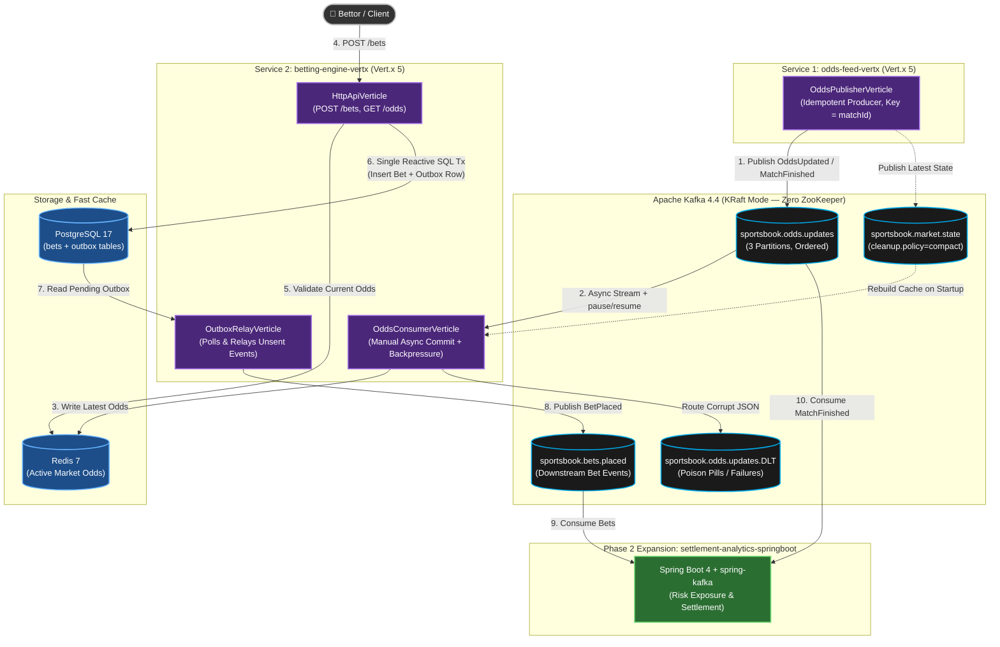

# ⚡ Reactive Sportsbook Engine — Apache Kafka 4.4 (KRaft) & Eclipse Vert.x 5

A hands-on, production-grade distributed systems lab simulating a high-throughput **Live Sportsbook Platform**. Built to master modern **Apache Kafka (KRaft mode)**, **non-blocking reactive programming with Eclipse Vert.x 5**, and **Java 25**.

---

## 🎯 System Overview

In a live Sportsbook, a single match event (e.g., a goal or red card) triggers thousands of rapid odds recalculations and concurrent user bet requests within milliseconds. This project solves three core distributed systems challenges:

1. **Strict Event Ordering:** Guaranteeing odds updates for the same match are processed sequentially while scaling horizontally across partitions.
2. **Non-Blocking Backpressure:** Protecting Vert.x Event Loop threads from overload during traffic spikes or downstream database slowdowns.
3. **Atomic Data Consistency (Dual-Write Problem):** Ensuring placed bets are saved in PostgreSQL and published to Kafka atomically using the Transactional Outbox pattern.

---

## 🏗️ High-Level Architecture


---

## 🛠️ Tech Stack

* **Language:** Java 25 (LTS)
* **Build Tool:** Gradle 9+ (Multi-module Kotlin DSL)
* **Reactive Framework:** Eclipse Vert.x 5 (`vertx-core`, `vertx-web`, `vertx-kafka-client`, `vertx-pg-client`, `vertx-redis-client`, `vertx-circuit-breaker`, `vertx-micrometer-metrics`)
* **Message Broker:** Apache Kafka 4.4.0 (KRaft mode — zero ZooKeeper)
* **Storage & Caching:** PostgreSQL 17, Redis 7
* **Observability & UI:** Redpanda Console, Prometheus, Grafana
* **Testing:** JUnit 5, `vertx-junit5`, Testcontainers
* **Phase 2 Expansion:** Spring Boot 4 (`spring-kafka`) for cross-framework comparison

---

## 📂 Repository Structure

```text
sportsbook-reactive-kafka/
├── AGENTS.md                        # Socratic pair-programming rules for AI mentor
├── ARCHITECTURE_DECISIONS.md        # Engineering log of trade-offs & configs learned
├── README.md                        # Project blueprint & milestone tracker
├── docker-compose.yml               # Local Kafka KRaft, Postgres, Redis & Observability stack
├── build.gradle.kts                 # Root Gradle build (Java 25 toolchain)
├── settings.gradle.kts              # Multi-module definitions
│
├── infra/                           # Infrastructure & monitoring configs
│   ├── prometheus/prometheus.yml
│   ├── grafana/dashboards/
│   └── postgres/init.sql
│
├── sportsbook-events/               # Shared contract module (Java 25 Records & Topic constants)
├── odds-feed-vertx/                 # Service 1: Reactive live odds & match result producer
├── betting-engine-vertx/            # Service 2: Reactive consumer, REST API, Redis cache & Outbox
└── settlement-analytics-springboot/ # (Phase 2) Spring Boot consumer for risk & settlement
```

---

## 🗺️ Learning Roadmap & Milestones

Check off each milestone only after implementing the code yourself, surviving the simulated production incident, and documenting your takeaways in `ARCHITECTURE_DECISIONS.md`.

### Milestone 1: KRaft Infrastructure & Reactive Producer
* [x] Configure `docker-compose.yml` with Apache Kafka 4.4.0 (KRaft combined mode), PostgreSQL 17, Redis 7, Redpanda Console, Prometheus, and Grafana.
* [x] Create topic `sportsbook.odds.updates` with **3 partitions**.
* [ ] Build `odds-feed-vertx` using `KafkaProducer` with `matchId` as the partition key, `acks=all`, and `enable.idempotence=true`.
* [ ] **Verification:** Prove in Redpanda Console that all events for a given `matchId` land on the exact same partition while spreading across all 3 partitions.

### Milestone 2: Non-Blocking Consumer & Async Offset Commits
* [ ] Build `OddsConsumerVerticle` in `betting-engine-vertx` with `enable.auto.commit=false`.
* [ ] Asynchronously write incoming odds to Redis (`vertx-redis-client`).
* [ ] Commit Kafka offsets **only after** the Redis `Future` completes successfully, without ever blocking the Vert.x Event Loop.

### Milestone 3: Backpressure, Rebalancing & Horizontal Scaling
* [ ] Simulate a slow Redis/downstream bottleneck.
* [ ] Implement reactive backpressure using `KafkaConsumer.pause()` and `resume()` based on in-flight async operation watermarks.
* [ ] Run 2 instances of `betting-engine-vertx` using `CooperativeStickyAssignor` and observe zero-stop-the-world partition rebalancing.

### Milestone 4: Poison Pills, Dead Letter Topics & Circuit Breaking
* [ ] Handle corrupt JSON payloads by routing them to `sportsbook.odds.updates.DLT` enriched with original offset, partition, and exception headers.
* [ ] Wrap downstream calls in `vertx-circuit-breaker` so repeated failures trip the circuit and cleanly pause Kafka consumption until recovery.

### Milestone 5: Transactional Outbox & Log-Compacted Topics
* [ ] Implement `POST /bets` in `HttpApiVerticle` to validate odds against Redis and insert into `bets` + `outbox` tables inside a **single reactive PostgreSQL transaction**.
* [ ] Build `OutboxRelayVerticle` to reliably publish pending outbox events to `sportsbook.bets.placed`.
* [ ] Configure a log-compacted topic (`cleanup.policy=compact`) for latest market odds and verify cache reconstruction from offset `0` on service startup.

### Milestone 6: Integration Testing & Observability
* [ ] Write end-to-end async integration tests using **Testcontainers** and `VertxTestContext` (zero `Thread.sleep()`).
* [ ] Propagate correlation/trace IDs across Kafka message headers.
* [ ] Expose Prometheus metrics (`vertx-micrometer-metrics`) and visualize `kafka_consumergroup_lag` and event-loop delay in Grafana.

### Phase 2 (Bonus): Spring Boot Interoperability
* [ ] Add `settlement-analytics-springboot` using **Spring Boot 4 + `spring-kafka`** to consume `sportsbook.bets.placed` and compare thread/concurrency models against Vert.x.

---

## 🚀 Quick Reference Commands

```bash
# Build all modules
./gradlew clean build

# Set POSTGRES_PASSWORD and GRAFANA_ADMIN_PASSWORD in the environment or an
# untracked .env file, then start the local infrastructure.
docker compose up -d

# Inspect Kafka consumer group lag via CLI
docker compose exec broker /opt/kafka/bin/kafka-consumer-groups.sh \
  --bootstrap-server broker:9092 \
  --describe --group betting-engine-group
```

The broker advertises `localhost:19092` to host clients and `broker:9092` to
containers. The topic initializer creates `sportsbook.odds.updates` with three
partitions if it does not already exist. Kafka data and controller metadata
persist in separate Docker volumes. This local setup has one broker, so topic
data is not replicated despite the three-controller quorum.
